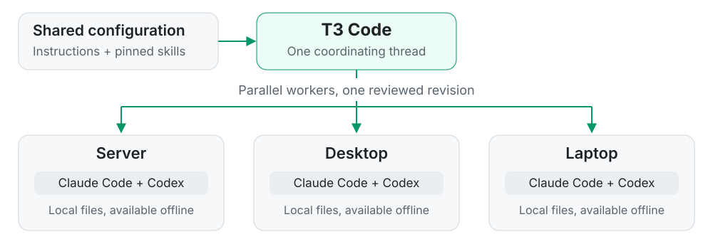

# Fleet

Shared instructions and skills for Claude Code and Codex, coordinated through **[T3 Code](https://github.com/pingdotgg/t3code)**. One thread previews changes across your linked computers, collects the results, and applies the revision you approve.



T3 Code is the core of this workflow. The Python installer handles each machine; T3 connects them. Every machine keeps a local copy for offline use. Syncs happen when you ask, with no background service.

This is a personal setup you can adapt. Read the [instructions](instructions.md) and [skill selection](skills.json) before installing them on your own machines.

## Start in a T3 Code thread

Clone this repository, or your own fork, into a permanent directory on the machine you want to coordinate from:

```sh
git clone https://github.com/muffe/fleet.git ~/.config/fleet
cd ~/.config/fleet
cp machines.example.json machines.json
```

Open that checkout in T3 Code and link the computers you want to manage. In the local `machines.json`, set your repository, each machine's T3 environment ID, and its permanent configuration directory. Choose `git` for an existing checkout or `snapshot` for deployed files. The template shows three machines; use as many as you need.

Then ask in the thread:

| You ask | Fleet does |
| --- | --- |
| **Dry run fleet** | Compares every configured machine against the same published commit, concurrently. |
| **Apply the reviewed changes everywhere** | Backs up affected files, deploys the reviewed configuration, installs skills, and verifies the result. |
| **Apply only to the laptop** | Limits deployment to the named machine. |

The [fleet skill](.agents/skills/fleet/SKILL.md) guides the coordinating agent. It collects one combined report, distinguishes offline or blocked machines, and archives worker threads after saving their results.

### What you see before applying

- **Instructions:** actual text diffs, replaced files, and changed link targets.
- **Skills:** added, modified, and removed files within each selected skill, plus Claude link changes.
- **Preserved files:** unrelated skills and provider-managed directories.
- **Side effects:** backups, package downloads, caches, and installation metadata.

Custom Markdown skills get text diffs. Upstream skills are compared using hashes tied to their pinned revisions. A missing or stale baseline blocks the comparison rather than guessing. A preview changes no active configuration.

<details>
<summary><strong>How deployment works</strong></summary>

Workers stage the same exact published commit in temporary directories. They leave live checkouts in place: updating a file already linked as global instructions would itself change active configuration. The dry-run-only `--target-checkout <path>` option predicts the permanent instruction links while comparing staged sources.

A `git` machine uses its existing checkout. A `snapshot` machine receives the installer and configuration files without needing a Git repository or T3 project registration. Snapshot ownership and file hashes are recorded in `.fleet-source.json`. Local drift is reported as a conflict rather than overwritten.

Private skills are transferred separately through T3 with matching file hashes. They are reviewed alongside the public commit and stay outside Git. If transfer is unavailable, the private portion is reported as blocked rather than silently skipped.

Reports live under `.fleet/runs/`, apply receipts under `.fleet/applies/`, and optional rollout summaries in `.fleet/rollout.json`. Worker history is preserved when threads are archived. Permission or connectivity blockers are reported.

</details>

## What lives where

Both agents use the same instruction source on each machine:

```text
<local fleet directory>/instructions.md
    ├── ~/.claude/CLAUDE.md
    └── ~/.codex/AGENTS.md
```

The two global files are symlinks to `instructions.md`. Skills are installed through the pinned `skills` npm package into `~/.agents/skills`, with links for Claude Code.

| Shared in this repo | Kept locally, ignored by Git |
| --- | --- |
| [`instructions.md`](instructions.md): common agent instructions | `machines.json`: real machine IDs and destinations |
| [`skills.json`](skills.json): 43 upstream skills at pinned commits | `skills.local.json`: additional private skill selections |
| [`skills-baseline.json`](skills-baseline.json): expected file hashes | `private-skills/`: private skill contents and references |
| [`machines.example.json`](machines.example.json): fleet template | `.fleet/`: reports, receipts, and other local state |
| [`scripts/`](scripts/): installer, comparison, and reporting | `~/.local/state/fleet/backups/`: backups created before apply |

Upstream skill contents stay in their original repositories. Fleet records the revisions and expected hashes. Provider credentials, account settings, and T3 Code settings are outside its scope.

## Run the installer directly

The per-machine engine also works without T3 Code. From your permanent checkout:

```sh
# Preview first. Running without flags does the same thing.
python3 scripts/install.py --dry-run

# Apply after reviewing the plan.
python3 scripts/install.py --apply
```

**Requirements:** Python 3, Git, and Node.js 22.20.0 or newer with `npx`. The package CLI is pinned to `skills@1.7.0`. Paths and symlinks are designed for Linux and macOS; native Windows has not been verified.

A dry run uses local files only. It creates no backups or bytecode caches, runs no package CLI, and makes no network requests. Applying can download the CLI and skill sources.

Useful variations:

```sh
python3 scripts/install.py --dry-run --only instructions
python3 scripts/install.py --dry-run --only skills
python3 scripts/install.py --dry-run --commands
python3 scripts/install.py --dry-run --json > fleet-dry-run.json
```

> Reports can contain private text from your current configuration. Keep them local. `fleet-dry-run.*` files are ignored by Git.

<details>
<summary><strong>Backups, verification, and apply behavior</strong></summary>

The installer backs up affected instructions, selected skill folders, agent links, and the skills lock under `~/.local/state/fleet/backups/`. It installs the selected skills, verifies their payloads, then links global instructions. Keep the fleet directory in place while those links are active. `CLAUDE_CONFIG_DIR` and `CODEX_HOME` override the respective instruction locations.

`--only instructions` and `--only skills` also work with `--apply`. Reapplying instruction links is idempotent. `CURRENT` means the content matches; applying still reinstalls selected skills and updates package metadata.

If a skill installation fails, earlier skill installations may already have completed. The installer stops before replacing instruction links, and backups remain available.

Unrelated skills, account-synced Claude skills, and Codex's bundled `.system` skills are preserved. Claude-specific workflows remain marked for Claude installation; discovery in a shared directory does not make them portable to Codex.

</details>

## Add private skills

Put private skills in `private-skills/` and select them in a local `skills.local.json`:

```json
{
  "custom": [
    {
      "name": "my-writing",
      "path": "private-skills/my-writing",
      "agents": ["claude-code", "codex"]
    }
  ]
}
```

```text
private-skills/
└── my-writing/
    ├── SKILL.md
    └── references/
        └── style.md
```

These skills use the same preview, backup, install, and verification flow. Their expected hashes come from the local source files. Paths must stay inside the checkout, names must be unique across both manifests, and entries contain only `name`, `path`, and `agents`. A missing selected directory blocks the preview.

Both the local manifest and `private-skills/` are ignored. Back them up separately: cloning this repo does not recover them. A checkout without private skills works on its own.

## Make it yours

Edit `instructions.md` for shared preferences. For upstream skills, update the selection or commit pins in `skills.json` and capture the matching hashes in `skills-baseline.json`. The installer rejects stale baselines; normal applies use pinned versions instead of upgrading to upstream HEAD.

The update cycle is:

```text
Edit → stage and preview → review → commit and push → apply → verify
```

Review a temporary source copy before updating a live checkout. Pulling directly into a checkout whose instructions are already linked changes those instructions immediately. Private changes need their own reviewed transfer and backup.

Keep machine mappings, private skills, inventories, rollout records, reports, and credentials out of commits. The ignore rules also cover legacy `rollout.json` and `sources/` paths, `.env` files, editor swap files, and dry-run output. Review staged changes before pushing: ignore rules do not remove existing Git history.

## Checks

```sh
PYTHONDONTWRITEBYTECODE=1 python3 -m unittest discover -s tests -v
```

Tests cover comparisons, stale baselines, private skill validation, symlink replacement, custom text diffs, preserved skills, read-only previews, instruction backup/idempotence, staged sources, and combined reports.
